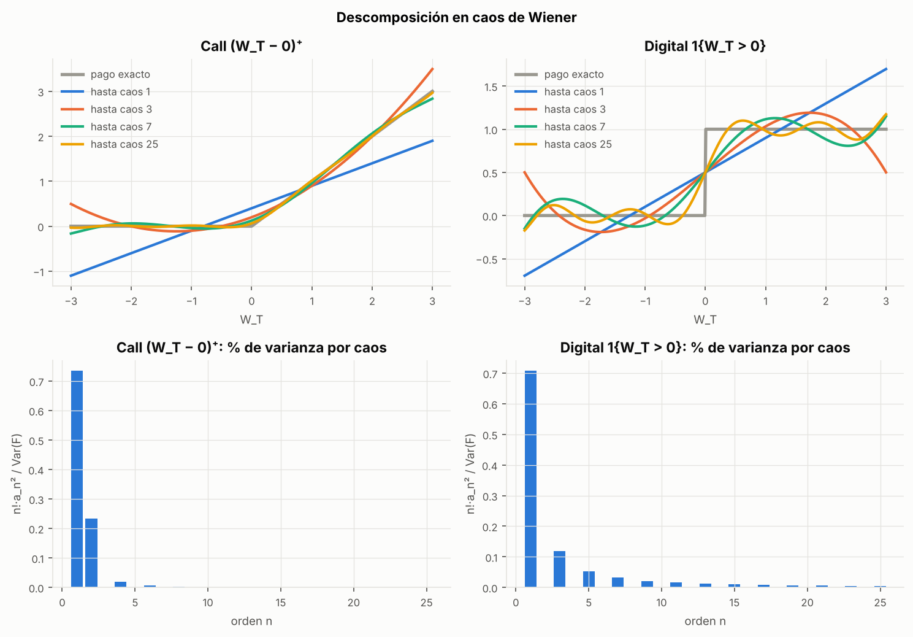
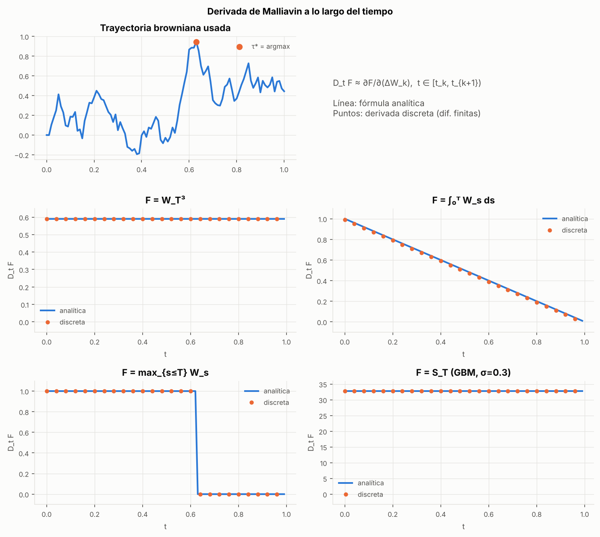
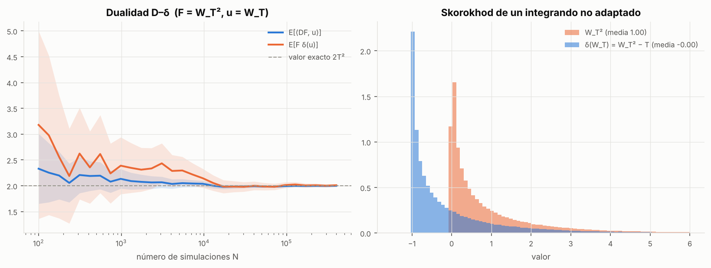
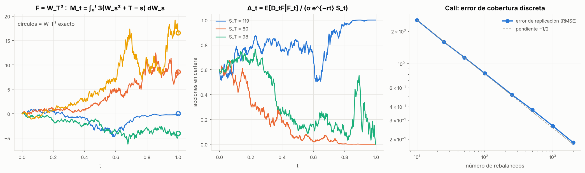
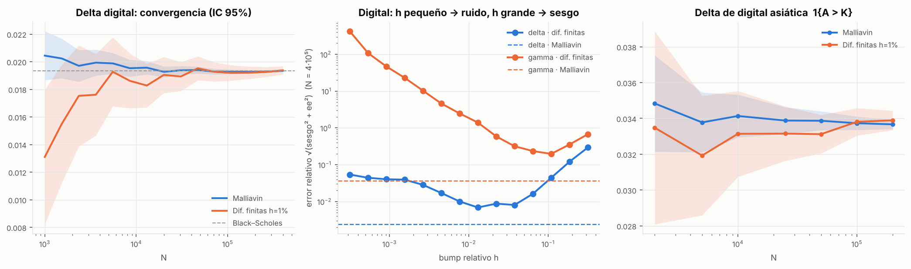
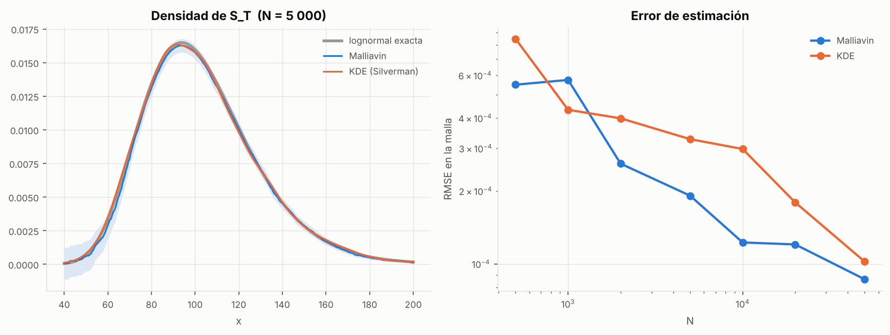
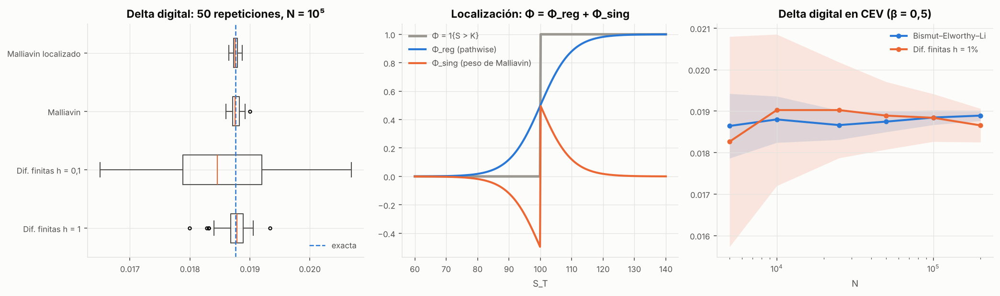
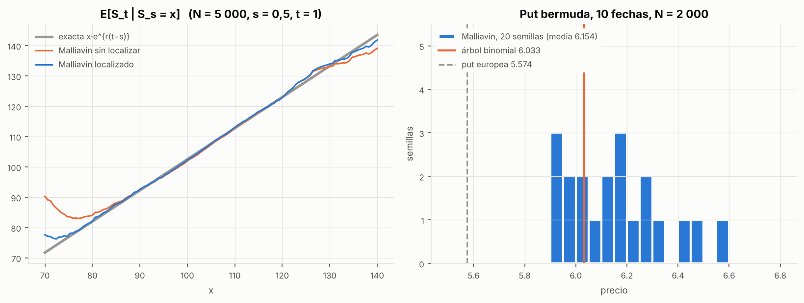

# IGR_Metrics_Claude — Cálculo de Malliavin y aplicaciones en finanzas

Proyecto cuantitativo, construido sobre la guía teórica
[*Cálculo de Malliavin: de los procesos estocásticos y la integral de Itô al estado del arte*](docs/pdf/Calculo_de_Malliavin_corregido.pdf),
para **entender y visualizar** el cálculo de Malliavin y sus aplicaciones
financieras (cobertura, griegas y densidades) mediante una pequeña librería Python, scripts de
visualización, un documento teórico en LaTeX y documentación bibliográfica.

## Contenido

| Carpeta | Qué hay |
|---|---|
| `src/malliavin/` | Librería: caos de Wiener, derivada de Malliavin, Skorokhod, Clark–Ocone, griegas (con localización y BEL), densidades, esperanzas condicionales y bermudas |
| `examples/` | Scripts `01`–`08` que generan las figuras de `figures/` |
| `tests/` | Verificación numérica de las identidades teóricas |
| `latex/` | Compañero numérico de la guía PDF (`main.tex`, capítulos, `referencias.bib`, `main.pdf`) |
| `docs/` | [Mapa PDF → código](docs/mapa_pdf.md), [guía de la librería](docs/guia_libreria.md), [bibliografía comentada](docs/bibliografia.md), [chuleta de teoría](docs/teoria_resumen.md), [PDF de teoría](docs/pdf/Calculo_de_Malliavin_corregido.pdf) |
| `AGENTS.md` | Instrucciones para agentes de IA que trabajen en el repo |

## Instalación y uso

```bash
pip install -e ".[dev]"
pytest                                   # verifica la teoría numéricamente
python examples/05_griegas_malliavin.py  # genera figures/05_griegas_malliavin.png
cd latex && latexmk -pdf main.tex        # compila el documento (requiere TeX Live + biber)
```

## Ejemplos

| Script | Concepto | Figura |
|---|---|---|
| `01_caos_de_wiener.py` | Desarrollo en polinomios de Hermite de una call y una digital |  |
| `02_derivada_malliavin.py` | D_tF analítica vs discreta para W_T³, ∫W, max W, S_T |  |
| `03_integracion_por_partes.py` | Dualidad E⟨DF,u⟩ = E[Fδ(u)] e integral de Skorokhod |  |
| `04_clark_ocone_cobertura.py` | Clark–Ocone y cobertura delta de Black–Scholes |  |
| `05_griegas_malliavin.py` | Griegas de digitales y asiáticas: Malliavin vs diferencias finitas |  |
| `06_densidad_malliavin.py` | Densidad de S_T por integración por partes vs KDE |  |
| `07_localizacion_y_bel.py` | Reproduce la tabla §12.7 de la guía; localización; Bismut–Elworthy–Li en CEV |  |
| `08_esperanza_condicional_bermudas.py` | E[S_t\|S_s=x] sin regresión (T. 14.1) y put bermuda vs árbol binomial |  |

## Ejemplo mínimo

```python
import numpy as np
from malliavin import greeks
from malliavin.brownian import rng

WT = rng(0).standard_normal(1_000_000)          # T = 1
g = greeks.greeks_malliavin(greeks.digital_payoff(100), WT, S0=100, T=1, r=0.03, sigma=0.2)
print(g["delta"], g["gamma"])                    # MCEstimate(value, stderr)
```
