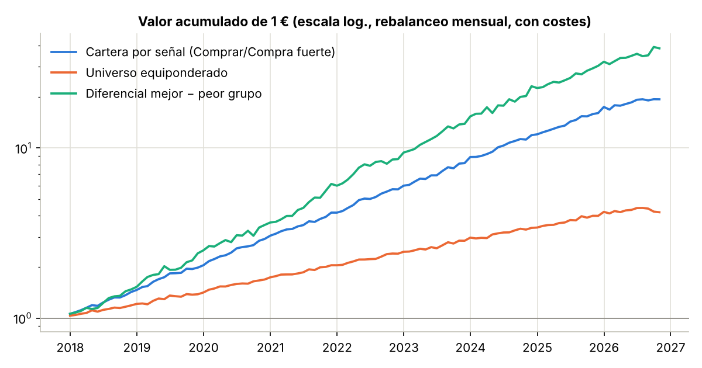
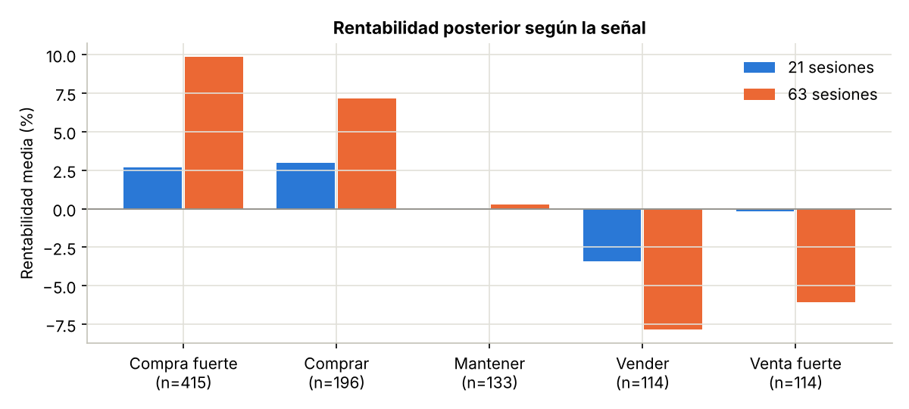
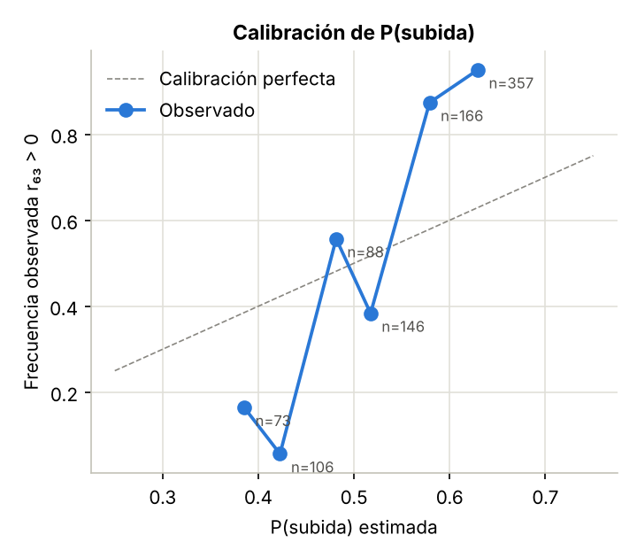

# Backtest «demo»

> **Datos sintéticos.** Este informe sólo comprueba que el proceso funciona: los precios demo tienen regímenes persistentes por construcción, así que las cifras **no dicen nada sobre mercados reales**. Para el backtest real ver `dashboard/backtest/README.md`.

Generado 2026-11-20 07:04 UTC · datos sintéticos (demo, semilla fija) · 9 valores · 972 observaciones mensuales · 2017-12-29 → 2026-11-20

Evalúa la **puntuación técnica** del dashboard (los fundamentales no tienen histórico point-in-time). Metodología y cómo reproducirlo: `dashboard/backtest/README.md`.

## Poder predictivo (IC de Spearman por fecha)

| Horizonte | IC medio | Desv. | t | Fechas |
|---|---|---|---|---|
| 21 sesiones | +0.266 | 0.319 | +8.57 | 106 |
| 63 sesiones | +0.659 | 0.168 | +39.99 | 104 |
| 63 sesiones, exceso vs índice | +0.622 | 0.190 | +33.28 | 104 |

Referencia: un IC medio de 0,02–0,05 con t > 2 ya se considera útil en factores de renta variable; |t| < 2 no es distinguible de cero.

## Rentabilidad posterior por recomendación

| Señal | Casos | r 21 s. | r 63 s. | Exceso 63 s. | % r₆₃ > 0 |
|---|---|---|---|---|---|
| Compra fuerte | 415 | +2.7 % | +9.8 % | +9.9 % | 95 % |
| Comprar | 196 | +3.0 % | +7.1 % | +7.1 % | 63 % |
| Mantener | 133 | +0.0 % | +0.3 % | +0.6 % | 56 % |
| Vender | 114 | -3.4 % | -7.8 % | -8.2 % | 18 % |
| Venta fuerte | 114 | -0.2 % | -6.1 % | -5.4 % | 11 % |

## Perspectiva a 1–3 meses

| Perspectiva | Casos | r 63 s. | Exceso 63 s. | Acierto |
|---|---|---|---|---|
| Alcista | 557 | +9.9 % | +9.9 % | 91 % |
| Lateral | 198 | +0.0 % | +0.2 % | 74 % |
| Bajista | 217 | -7.2 % | -7.0 % | 88 % |

Acierto: Alcista ⇒ r₆₃ > 0; Bajista ⇒ r₆₃ < 0; Lateral ⇒ |log(1+r₆₃)| < ½·σ₆₃·√(63/252).

Cobertura de los rangos ±1σ (ideal ≈ 68 %): 1 mes 85 %, 3 meses 91 %.

## Calibración de P(subida) a 63 sesiones

| Tramo | Casos | P media | Frecuencia observada |
|---|---|---|---|
| < 40 % | 73 | 39 % | 16 % |
| 40–45 % | 106 | 42 % | 6 % |
| 45–50 % | 88 | 48 % | 56 % |
| 50–55 % | 146 | 52 % | 38 % |
| 55–60 % | 166 | 58 % | 87 % |
| ≥ 60 % | 357 | 63 % | 95 % |

## Carteras mensuales (coste 10 pb por rotación)

| Cartera | CAGR | Volatilidad | Sharpe | Máx. caída |
|---|---|---|---|---|
| Por señal (Comprar/Compra fuerte, si no liquidez) | +39.4 % | 8 % | 4.29 | -3.6 % |
| Universo equiponderado | +17.4 % | 7 % | 2.51 | -5.7 % |
| Diferencial mejor − peor grupo | +50.6 % | 15 % | 2.92 | -7.4 % |

La cartera por señal estuvo invertida el 100 % de los meses; rotación media mensual 0.30.

## Limitaciones

- Sesgo de supervivencia: el universo son los valores elegidos hoy, que existen hoy.
- Sólo técnico; los umbrales no se han optimizado con estos datos (no hay sobreajuste, pero tampoco calibración).
- Observaciones a 63 sesiones solapadas mes a mes: los t del IC y los aciertos están algo inflados; las carteras usan rentabilidades mensuales no solapadas.
