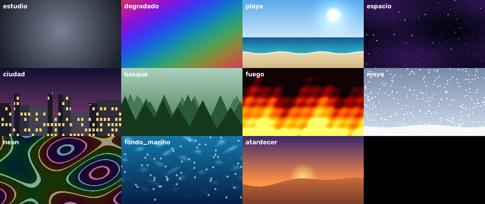

# Estudio de vídeo

Herramienta independiente para **crear y editar vídeos dándole órdenes en español** y para
**transformarte delante de la cámara**: cambiar el entorno (fondo), el cuerpo y la cara.



## Instalación

```bash
cd estudio_video
pip install -r requirements.txt            # crear, editar y procesar archivos
# Para la cámara en directo (ventana + segmentación con IA):
pip uninstall -y opencv-python-headless && pip install -r requirements-camara.txt
```

`ffmpeg` se usa del sistema si existe; si no, el que trae `imageio-ffmpeg`.
La primera vez que uses la cámara se descargan dos modelos de MediaPipe (~0,5 MB) a
`~/.cache/estudio_video`. En Linux MediaPipe necesita `libegl1` y `libgles2`.

## 1. Crear un vídeo diciéndole lo que quieres

```bash
python -m videostudio crear "Vídeo vertical de 15 segundos sobre mis vacaciones: \
  Llegamos a la playa. Bailamos en una fiesta. Volvimos al atardecer."
```

* Lo que va tras «:» son las escenas (una por frase). Sin «:», cada frase es una escena.
* Detecta la **duración** («15 segundos», «1 minuto») y el **formato**: vertical / TikTok /
  Reels → 720×1280; cuadrado → 1080×1080; por defecto horizontal 1280×720.
* Cada escena elige su **entorno** por palabras clave (playa, espacio, ciudad, bosque, fuego,
  nieve, fiesta/neón, fondo marino, atardecer…); si no nombra ninguno, hereda el global.
* `--musica cancion.mp3` añade audio. El resultado va a `salidas/`.

Para retocar el guion antes de renderizar:

```bash
python -m videostudio guion "vídeo sobre un viaje al espacio: ..." -o guion.json
# edita textos, duraciones, entornos o transiciones (fundido, corte, deslizar) en guion.json
python -m videostudio crear --guion guion.json
```

Ejemplo generado: [`ejemplos/viaje.mp4`](ejemplos/viaje.mp4).

## 2. Cámara: cambiar entorno, cuerpo y cara

```bash
python -m videostudio camara "ponme en la playa con cara de robot"
```

Se abre una ventana con tu cámara. Mientras tanto, **escribe órdenes en la terminal** y pulsa
Enter; se acumulan:

| Dices… | Pasa… |
|---|---|
| `llévame al espacio` | entorno espacio |
| `cara de alien` / `careta de emoji` | sólo cambia la cara |
| `cuerpo de dibujo animado` / `hazme un zombi` | efecto en toda tu figura |
| `desenfoca el fondo` | estilo videollamada |
| `quita la cara` / `quítame el fondo` / `quita todo` | deshace |

Teclas en la ventana: `1`–`9` looks rápidos, `0` original, `r` grabar/parar, `f` foto, `q` salir.
También por orden: «graba», «para», «haz una foto», «salir».
Las fotos y vídeos se guardan en `salidas/`.

**Efectos** (cuerpo o cara): dibujo, boceto, neon, termico, pixel, difuminar, oro, robot,
zombi, alien, fantasma, glitch, comic, emoji. **Entornos**: estudio, degradado, playa,
espacio, ciudad, bosque, fuego, nieve, neon, fondo_marino, atardecer
(`python -m videostudio opciones`).

Tus propios recursos:

```bash
python -m videostudio camara --fondo mi_salon.jpg --cara mi_avatar.png   # PNG con transparencia
```

Sin MediaPipe (`--motor opencv`) funciona igual pero el recorte de la persona usa una foto
del fondo vacío: sal del encuadre 2 s al arrancar.

### Órdenes por voz

```bash
python -m videostudio camara --voz                       # di «ponme en la playa», «cara de robot», «graba»…
python -m videostudio camara --voz --palabra-clave estudio  # sólo obedece «estudio, …» (evita falsos disparos)
python -m videostudio crear --voz                        # dicta el vídeo entero
```

El reconocimiento es **local** (Vosk): el audio no sale del ordenador. La primera vez se
descarga el modelo de español (~40 MB). Al dictar un vídeo, Vosk no pone signos: di «dos
puntos» tras el título, «punto» o «siguiente escena» entre escenas y termina con «fin del
vídeo» (o calla 3 s). Ejemplo: «un viaje dos puntos despegamos punto vemos las estrellas
punto volvemos a casa fin del vídeo».

## 3. Aplicar un look a un vídeo ya grabado

```bash
python -m videostudio procesar mi_video.mp4 "fondo de ciudad y cuerpo de cómic" -o resultado.mp4
```

Conserva el audio original.

## 4. Editar vídeos

```bash
python -m videostudio editar recortar  v.mp4 --inicio 2 --fin 8 -o corto.mp4
python -m videostudio editar unir      a.mp4 b.mp4 c.mp4      -o todo.mp4
python -m videostudio editar velocidad v.mp4 --factor 0.5     -o lento.mp4
python -m videostudio editar musica    v.mp4 --audio m.mp3 --mezclar -o con_musica.mp4
python -m videostudio editar rotulo    v.mp4 --texto "¡Hola!" --posicion abajo -o r.mp4
python -m videostudio editar filtro    v.mp4 --nombre sepia   -o sepia.mp4   # blanco_negro, vintage, brillo, frio, calido, espejo, reves
python -m videostudio editar formato   v.mp4 --nombre vertical -o tiktok.mp4 # rellena con fondo desenfocado
python -m videostudio editar gif       v.mp4                  -o v.gif
```

## Modo IA (opcional): órdenes más libres con Claude

Añade `--ia` a `crear`, `guion`, `camara` o `procesar`. Necesita `pip install anthropic` y
credenciales (`ANTHROPIC_API_KEY`). Claude escribe el guion (escenas, duración, entornos) o
traduce órdenes libres («quiero parecer un personaje de videojuego en una galaxia») a los
efectos disponibles. Si no hay clave, conexión o respuesta válida, vuelve solo a las reglas
sin red. Usa la opción de *fallback* del servidor para que una negativa del modelo se reintente
con otro modelo.

## Privacidad, derechos de imagen y de autor

El repositorio es **público**, pero tus vídeos no: se guardan en `salidas/` (ignorado por git)
y la cámara y el micrófono se procesan en tu ordenador. Los vídeos con efectos llevan la marca
«Modificado con IA» y metadatos de contenido sintético. Detalles (consentimiento de otras
personas, música, licencias): [DERECHOS.md](DERECHOS.md).

## Qué hace y qué no

* **Sí**: entornos animados generados por código, recorte de la persona con IA local
  (MediaPipe, sin enviar tu imagen a ningún sitio), efectos estilizados de cuerpo y cara,
  caretas con tu propia imagen, edición con ffmpeg.
* **No** (por ahora): vídeo fotorrealista generado por IA (tipo Sora/Veo/Runway) ni
  intercambio realista de cara con otra persona (*deepfake*). Lo primero requeriría un
  servicio externo de pago; ver «Ideas» en `AGENTS.md`.
